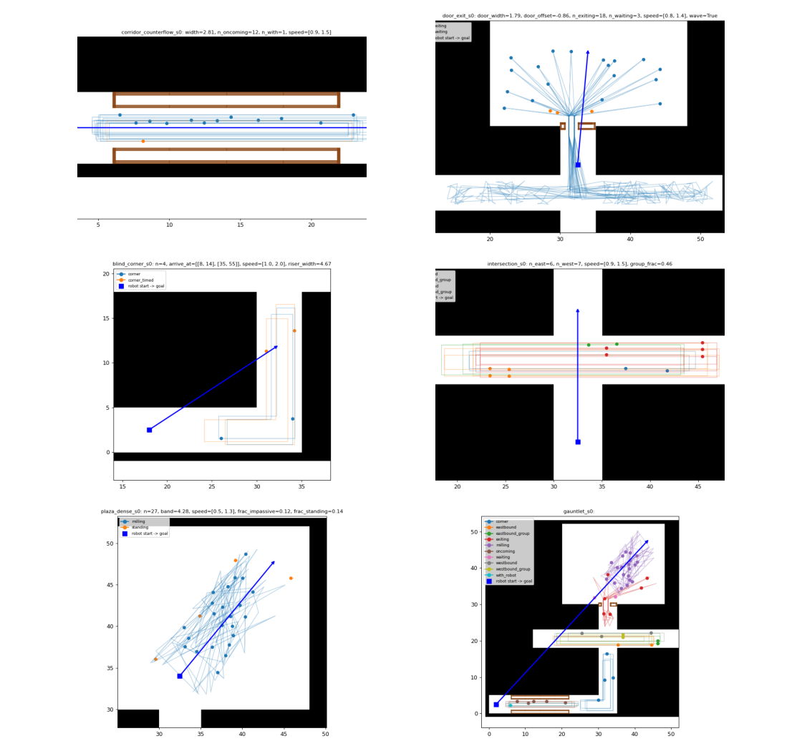
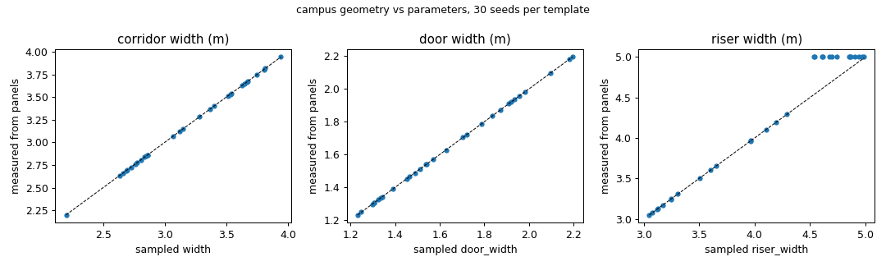
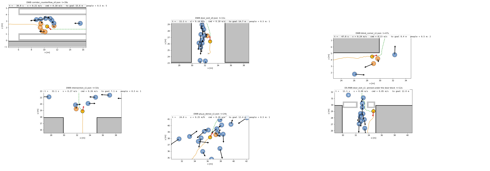

# 14. The campus stress-test world

**One world that contains every crowd-navigation stress situation** (a narrowed corridor with two-way traffic, a
doorway against an exiting crowd, a blind corner, an intersection with crossing streams, a dense plaza), plus a
**procedural scenario generator** that turns parameter ranges and a seed into Arena scenarios, and the tools that
verify them in simulation. Built and verified 2026-10-11/12 (DWB and DS-RNN, §10).

| File | What it is |
|---|---|
| [`scripts/generate_campus.py`](../scripts/generate_campus.py) | Builds the world shell → `worlds/campus/` (map, walls, zones, `default.json`, `warmup.json`) |
| [`scripts/generate_campus_scenario.py`](../scripts/generate_campus_scenario.py) | Templates + parameters + seed → scenario JSON, preview, per-scenario Nav2 map, `manifest.csv`; static checks |
| [`scenarios/campus/stress.yaml`](../scenarios/campus/stress.yaml) | The spec: templates, parameter ranges, HuNav defaults |
| `worlds/campus/` | Generated output (don't edit by hand). Seeds 0–4 of every template are committed |
| [`campus_verification/`](../campus_verification/) | `verify.py` (per-episode checks), `params_check.py`, `plan_check.py`, `reset_jump.py`, `hot_switch.py` (runner with warm-up / priming / timeout) |

TL;DR:
```bash
uv run scripts/generate_campus.py --link                                     # world (once)
uv run scripts/generate_campus_scenario.py scenarios/campus/stress.yaml --seeds 0 29 --link
cd ~/arena_ws && source arena.bash && colcon build --symlink-install --packages-select arena_simulation_setup
cd ~/Documents/Lyu_Lab/initial-arena-testing
uv run campus_verification/hot_switch.py --planner dwb --prime --timeout 300 --out ~/arena_runs/campus_dwb \
    door_exit_s0.json door_exit_s1.json blind_corner_s0.json                 # several scenarios, one launch
uv run campus_verification/verify.py ~/arena_runs/campus_dwb --out table.csv  # checks + stress metrics
```

---

## 1. The mental model: what is static, what is per-run

| Layer | Files | Changes when | Contains |
|---|---|---|---|
| **World** | `worlds/campus/map/map.png`, `map.yaml`, `walls.yaml` | Only at launch | The building's walls. Gazebo builds wall boxes from `walls.yaml`; Nav2 plans on the map |
| **Scenario** | `worlds/campus/scenarios/<s>.json` (+ `map/scenario_maps/<s>.{png,yaml}`) | Every reset (hot-switchable, §9) | Robot start and goal; pedestrians (start, waypoints, speed, HuNav behaviour, groups); wall **panels**; its own Nav2 map with the panels drawn in |

The trick for "one world, many geometries": the shell is **generous** (5 m-wide corridors, a 5 m-wide door
opening). Each scenario **narrows it** with wall panels (static obstacles). A 2.2 m corridor and a 3.8 m corridor
are two scenario files, not two worlds.

Our files live in this repo and are **symlinked** into `~/arena_ws/src/arena/simulation-setup/worlds/campus/` file
by file (`--link`). Editing a linked file needs nothing else; **new** files need `--link` and a rebuild of
`arena_simulation_setup` (~25 s). **Deleting** a linked file also leaves dangling links in
`~/arena_ws/build/arena_simulation_setup` and `install/` that make the next build fail ("can't copy ... doesn't
exist"): `find ~/arena_ws/build/arena_simulation_setup ~/arena_ws/install/arena_simulation_setup -xtype l -delete`.

---

## 2. The layout as built


| Zone | Rectangle (x0, y0, x1, y1) | Used by |
|---|---|---|
| `corridor` | (0, 0, 35, 5) | `corridor_counterflow` (narrowed x 6–22); its east end (x 30–35) is the **blind corner** |
| `riser` | (30, 0, 35, 30) | `blind_corner` (y < 17), `door_exit` (y 23–30), the robot's way north |
| `crossing` | (12, 18, 53, 23) | `intersection` (streams), `door_exit` (exit wave disperses here) |
| `plaza` | (20, 30, 48, 52) | `plaza_dense`; its south wall has the **door** (shell opening x 30–35 at y = 30) |

The union is one hole-free polygon (a tree of rectangles): 1096 m² of floor, 18 axis-aligned wall segments, a
1100 × 1080 px map at 0.05 m. `generate_campus.py` checks connectivity, holes and axis alignment.

**Anchors** (`worlds/campus/zones.yaml`): `corridor_west` (2, 2.5), `corridor_mid` (18, 2.5), `corridor_east`
(26, 2.5), `corner` (32.5, 2.5), `riser_mid` (32.5, 12), `intersection` (32.5, 20.5), `crossing_west` (14, 20.5),
`crossing_east` (51, 20.5), `below_door` (32.5, 26), `above_door` (32.5, 34), `plaza_center` (34, 41),
`plaza_far` (44, 48).

Scenarios of the world itself:
- `default.json`: the **gauntlet task** (corridor_west → plaza_far, ~80 m) with nobody else. DWB drives it in
  **318.8 s** (checkpoint, 2026-10-11).
- `warmup.json`: a 4 m drive, nobody else. `hot_switch.py` launches with it and then switches (§10.1).

Design rules (each one a lesson from the hallway): everything axis-aligned (HuNav's obstacle boxes are
axis-aligned, rotated walls became phantom walls, [09 §4](09-hallway-scenarios.md)); a tree, not a loop (one outer
ring, `gen_walls()` works unchanged); zones separated so templates can run alone or together (the gauntlet). Goals
are ≥ 3 m from walls *ahead* of the robot where the zone allows it (the corridors are 5 m wide, so corridor goals
are 2.5 m from the side walls, but never facing an end wall).

---

## 3. Building the world (`generate_campus.py`)

```bash
uv run scripts/generate_campus.py          # writes worlds/campus/ (map, walls, zones.yaml, default/warmup, preview.png)
uv run scripts/generate_campus.py --link   # ...and links map/ + scenarios/ into Arena (then rebuild, §1)
```
`build_free_space` unions `ZONES` (error if a zone is disconnected or the zones enclose a hole), `build_walls`
pushes the outline out by half a wall thickness (`gen_walls` from the hallway generator; the clear widths stay
exact) and asserts every segment is axis-aligned, `save_map_png_with_holes` paints the floor white. Change the
layout by editing `ZONES` / `DOOR` / `ANCHORS` at the top; the templates read everything from `zones.yaml`.

---

## 4. Anatomy of a scenario JSON

```json
{
  "robots": [{"start": [32.5, 24.5, 0.0], "goal": [34.0, 41.0, 0.0]}],
  "obstacles": {
    "static":  [{"name": "panel_y1_0", "model": "panel_y1", "pos": [30.1, 30.0, 0.0]}, "..."],
    "dynamic": [{"name": "exiting_0", "model": "actor1", "type": 1,
                 "pos": [44.2, 38.1, 0.0], "waypoints": [[31.3, 31.4, 0.0], [31.3, 30.0, 0.0], "..."],
                 "desired_velocity": 1.02, "group_id": -1, "class": "exiting",
                 "radius": 0.35, "goal_radius": 0.6, "cyclic_goals": true,
                 "behavior": {"type": 1, "social_force_factor": 20.0, "obstacle_force_factor": 30.0}}],
    "interactive": []
  },
  "map": "scenario_maps/door_exit_s0.yaml"
}
```
- `static`: models from `simulation-setup/entities/obstacles/static/<model>/`; `pos` = [x, y, yaw]. A misspelt
  model is silently missing (Arena logs `Error spawning entity`).
- `dynamic`: HuNav pedestrians ([09 §3](09-hallway-scenarios.md)). Gotchas, all enforced by the generator's
  `check_scenario()` (generation fails otherwise):
  - force factors and speeds must be **floats**: an integer (`12`) makes Arena's HuNav adapter drop the agent
    ("must be of type 'float'"), and the episode silently runs without it;
  - **`cyclic_goals` must stay true**: an agent that reaches its last goal crashes the HuNav Gazebo plugin
    (segfault in `HuNavSystemPluginIGN::PreUpdate`, the launch dies);
  - every leg of a route (including last → first) must be in line of sight with body clearance (no path
    planning), every waypoint ≥ 0.45 m inside the free space;
  - `type` = 1; `social_force_factor` set (default 0 = people walk through each other).
- `map`: the per-scenario Nav2 map (§9), written by `scripts/scenario_maps.py` (called for every scenario;
  `--no-map` to skip).
- `class` is ours (Arena ignores it); `verify.py` and the previews use it.

---

## 5. Panels: adjusting geometry per scenario

Thin wall panels in simulation-setup (`entities/obstacles/static/panel_*`, commit `f03b9dd1` on `lyu-lab`):

| Model | Size (x × y × height) |
|---|---|
| `panel_x05`, `panel_x1`, `panel_x2`, `panel_x4` | 0.5 / 1 / 2 / 4 m × 0.2 m × 2 m (long along **x**) |
| `panel_y05`, `panel_y1`, `panel_y2`, `panel_y4` | 0.2 m × 0.5 / 1 / 2 / 4 m × 2 m (long along **y**) |

- `b.wall(x0, y0, x1, y1)`: a 0.2 m wall along an axis-aligned line, from the longest panels that fit.
- `b.block_rect(x0, y0, x1, y1)`: closes off a rectangle with its **outline** in panels, drawn just inside, so the
  free space ends exactly at its edges. The inside of a block is empty but unreachable (keep that in mind when you
  measure free space: `params_check.py` uses the free piece that contains a reference point).

Rules: **never rotate a panel** (HuNav uses the unrotated box); **name panels by model** (`wall()` does; Arena only
moves known names across hot switches, never re-spawns them); **doors ≥ 1.2 m**; cost is negligible (60 panels:
RTF unchanged).

---

## 6. Scenario templates



A template is `f(campus, b, p)`: `campus` gives zones and anchors, `b` is the `Builder`, `p` the **sampled**
parameters. Building blocks used by all templates:
- `b.add_on_loop(cls, route, speed, phase=None)`: a pedestrian on a **closed route**, placed at a random point
  along it (`phase_on_loop`, uniform by length, optionally restricted to some legs). Spreading a population
  uniformly along its loops from t = 0 is what keeps a zone busy **whenever** the robot arrives (DWB gets
  everywhere ~4× later than DS-RNN).
- `b.is_clear(pt)`: ≥ 0.9 m from every other start, ≥ 1.5 m from the robot's start and goal (nobody spawns on the
  robot or parks on its goal).
- **Lanes, never one shared line.** Two HuNav people walking the same line in opposite directions meet exactly
  head-on; the social force then has no sideways component, the goal force (hard-coded 20 in Arena) wins, and
  they walk *through* each other. Every two-way flow therefore has keep-right lanes ≥ 0.6–0.7 m apart (§8).

### 6.1 `corridor_counterflow`: two-way traffic in a narrowed corridor
- **Stresses:** passing oncoming people and being overtaken in a corridor 2–4 m wide.
- **Geometry:** panel strips along both long walls between x = 6 and 22 leave `width` clear (5 m shell).
- **Robot:** corridor_west (2, 2.5) → corridor_east (26, 2.5), through the whole narrow section.
- **Crowd:** `n_oncoming` start on their westbound leg (coming at the robot), `n_with` on their eastbound leg.
  Everyone loops between a west turnaround (x 4.5–6) and an east one (x 22.5–24.5), randomised per person;
  westbound in the north half, eastbound in the south half (lanes ≥ 0.6 m apart).
- **Timing:** starts uniform along the starting leg → oncoming people from the first second; loops keep the
  corridor busy (DWB: 27–33 head-on passes during its ~60 s in the narrow part).

| Parameter | Range |
|---|---|
| `width` | 2.0–4.0 m |
| `n_oncoming` / `n_with` | 6–12 / 0–4 |
| `speed` (per person) | 0.9–1.5 m/s |

### 6.2 `door_exit`: doorway against an exiting crowd
- **Stresses:** waiting vs pushing at a bottleneck; a crowd streaming down the riser at the robot.
- **Geometry:** the 5 m opening is closed to a door of `door_width` centred at 32.5 + `door_offset` (clipped so
  each side block is ≥ 0.5 m), with 1 m-deep blocks (y 29.5–30.5).
- **Robot:** the riser at (32.5, 24.5) (6 m below the door) → plaza_center (34, 41).
- **Crowd (`wave: true`, standalone):** `n_exiting` people with homes in the southern plaza (1.8–11 m from the
  door) all walk out at t = 0: waypoints above, in, and below the door (nobody catches on the frame), down the
  riser past the robot, through the intersection to a spot 4–18 m along the crossing corridor, mill there
  (10 points within 2 m, ~20 m of walking), then walk back up through the door home. `n_waiting` people stand
  beside the door on the plaza side.
- **Timing:** the exit wave fills the door during the first ~10–30 s: DS-RNN (1 m/s) meets it in the door, DWB
  (~23 s to the door) meets its tail and everyone walking down the riser at it (DWB: 7–18 people exited while
  the robot was within 3 m of the door). The return wave (same direction as the robot) reaches the door after
  ~45 s. Exits and returns are separated **on purpose**: in a single-file door HuNav people cannot take turns.
- **`wave: false` (gauntlet):** everyone loops plaza ↔ riser through the door at random phases (two-way traffic
  whenever the robot arrives); needs two lanes, so `door_width ≥ 1.7 m` (lanes w − 1.0 ≥ 0.7 m apart).

| Parameter | Range |
|---|---|
| `door_width` | 1.2–2.2 m (gauntlet 1.7–2.4) |
| `door_offset` | −1 … 1 m |
| `n_exiting` / `n_waiting` | 10–20 / 0–3 (gauntlet 6–10 / 0–2) |
| `speed` | 0.8–1.4 m/s |

### 6.3 `blind_corner`
- **Stresses:** occlusion and reaction time; people appear from behind the wall corner (30, 5) with little warning.
- **Geometry:** the L-turn corridor → riser; `riser_width` < 4.5 m narrows the riser above the corner (panels
  along its east wall, y 5.5–16.5); 4.5–5 leaves the full 5 m.
- **Robot:** corridor_mid (18, 2.5) → the riser at y = 12 (centred in the possibly narrowed riser).
- **Crowd:** `n` people loop: down the riser's west side, round the **inside** of the corner (1 m from the hidden
  wall corner, where the robot turns), west along the corridor at y 2.8–3.6 to x 24–27, back east along the
  south half, up the east side, cross over at y 14–17 (≥ 2 m above the robot's goal). The westbound lane stays
  ≥ 1.4 m off the north wall: planners hug that wall round the inside corner, and with the lane on that line a
  stopped DWB robot sat on the walkers' turn point and they pushed into it for minutes (HuNav people can't
  route around an obstacle).
- **Timing:** the first walkers are **timed**: placed so they reach the corner at a time drawn from each
  `arrive_at` window ([8, 14] s for DS-RNN's arrival, [35, 55] s for DWB's); the rest are uniform along the loop.
  DWB saw 4–11 people come round the corner while it was within the corner window.

| Parameter | Range |
|---|---|
| `n` | 4–8 (gauntlet 4–6, no timed walkers) |
| `speed` | 1.0–2.0 m/s |
| `riser_width` | 3.0–5.0 m |
| `arrive_at` | windows [8, 14], [35, 55] s |

### 6.4 `intersection`: crossing streams
- **Stresses:** finding a gap in perpendicular traffic.
- **Robot:** riser_mid (32.5, 12) → below_door (32.5, 26), straight across the crossing corridor.
- **Crowd:** `n_east` start walking +x, `n_west` −x, looping along the crossing corridor between turnarounds at
  x 17–24 and 41–48 (keep right; each person crosses the riser twice per ~45 m loop). A fraction `group_frac`
  walk in pairs/triples (shared `group_id`, parallel lanes 0.7 m apart, same phase).
- **Timing:** starts uniform along the starting leg; DWB saw 31–44 riser crossings per minute while in the zone.

| Parameter | Range |
|---|---|
| `n_east` / `n_west` | 4–10 each (gauntlet 3–6) |
| `speed` | 0.9–1.5 m/s |
| `group_frac` | 0–0.5 |

### 6.5 `plaza_dense`
- **Stresses:** density beyond what DS-RNN was trained on (5 people); milling in all directions.
- **Robot:** above_door (32.5, 34) → plaza_far (44, 48), an 18 m diagonal.
- **Crowd:** `n` people mill on loops of 3–5 random points (legs ≥ 3 m) in a band of half-width `band` around
  the start–goal line (≥ 1.5 m off walls, ≥ 2 m from start/goal); `frac_standing` stand still, `frac_impassive`
  get HuNav behaviour 2. Density ≈ n / (18 m × 2·band) = 0.1–0.3 people/m². DWB had 4.6–5.7 people within 2 m on
  average while crossing.

| Parameter | Range |
|---|---|
| `n` | 15–35 (gauntlet 12–20) |
| `band` | 3–5 m |
| `speed` | 0.5–1.3 m/s |
| `frac_impassive` / `frac_standing` | 0–0.3 / 0–0.15 |

### 6.6 `gauntlet`
Every template above with its own (smaller) parameter block, then the robot task corridor_west → plaza_far
(~80 m, 37–52 people). Every population lives on closed loops in its own zone at random phases, so each zone is
busy whenever the robot reaches it (DS-RNN reaches the plaza after ~1.5 min, DWB after ~5 min). `door_exit` runs
with `wave: false` (two-way door traffic, door ≥ 1.7 m); `blind_corner` without timed walkers.

---

## 7. Procedural generation: seeds, ranges, manifest, checks

```bash
uv run scripts/generate_campus_scenario.py scenarios/campus/stress.yaml --seeds 0 29 --no-preview --link
uv run scripts/generate_campus_scenario.py scenarios/campus/stress.yaml --only door_exit --seeds 0 4
uv run campus_verification/params_check.py --seeds 30 --fig docs/img/campus_params.png
```
- **Same spec + seed → identical JSON** (each (template, seed) has its own RNG stream; checked for 6 templates
  × 30 seeds by `params_check.py`).
- `worlds/campus/scenarios/manifest.csv`: the sampled parameters of every file; join it with recorded outcomes.
- Every scenario passes `check_scenario()` before it is written (§4), and gets a per-scenario map.
- Previews: `worlds/campus/previews/` (only `*_s0.png` are committed).

**Do the scenarios respond to their parameters?** (`params_check.py`, 30 seeds per template,
[output](../campus_verification/params_check.txt)): every parameter spans its range (e.g. corridor width
2.20–3.94, door width 1.23–2.20, offset −0.97…0.83, n_exiting 10–20, riser width 3.05–4.99, group_frac 0.02–0.48,
plaza n 15–35); the clear widths **measured from the panels** equal the parameters to ≤ 0.001 m (corridor, door,
riser; figure below); class counts equal the count parameters; desired speeds stay in their ranges; consecutive
seeds move the pedestrian starts by 0.55–3.96 m on average.



---

## 8. Pedestrian behaviour: forces, lanes, and what HuNav can't do

**Force factors.** Arena hard-codes HuNav's goal force factor to 20 (lightsfm's default is 2), so the old
hallway values (social 5, obstacle 10) were ~10× too weak *relative to the goal pull*. In dense two-way flows
people overlapped (< 0.4 m centre distance) 21–24% of the time. Measured (DWB, same seeds, 70 s each):

| social / obstacle | corridor | door (two-way) | intersection | plaza |
|---|---|---|---|---|
| 5 / 10 | 23% | 24% | 3% | 9% |
| 12 / 20 | 10% | 21% | 2% | 7% |
| 20 / 30 | 9% | 21% | 1% | 4% |
| **20 / 30 + lanes + one-way door wave (final)** | **4–10%** | **5–8%** | **0–1%** | **5–6%** |

The door didn't improve with forces at all: the remaining overlap came from head-on encounters on the same line
in the single-file door, fixed by the template design (§6). Obstacle 10 instead of 30 lets people come closer to
the robot (DWB min clearance 0.07–0.23 m vs 0.26–0.45 m) but they then clip ~0.3 m into panels, so 30 is kept.

**Reacting to the robot.** HuNav behaviours 3–6 need robot tracking, which our HuNav plugin has commented out.
People treat the robot as an **obstacle** (they swerve around it), never yield to it, anticipate it or react
socially. lightsfm uses only the **closest** obstacle: when the robot squeezes someone against a wall, the wall
force is ignored and the person can be pushed partly into it (seen once: 0.53 m for 0.9 s, blind_corner_s1 with
DS-RNN hugging the inside corner).

---

## 9. Running many scenarios (and per-scenario maps)

**Scenarios can be switched without relaunching** (verified). The task generator re-reads `task.scenario.file`
whenever it changes, and the next reset uses the new file: pedestrians, robot start and goal, static obstacles
(removed panels are deleted, new ones spawned) and, since our patch, the map. By hand:

```bash
ros2 service call /task_generator_node/set_parameters rcl_interfaces/srv/SetParameters \
  "{parameters: [{name: task.scenario.file, value: {type: 4, string_value: door_exit_s3.json}}]}"
ros2 service call /task_generator_node/reset_task std_srvs/srv/Empty "{}"     # optional: switch right now
```
(`ros2 param set` hung against the task generator; the service call works.)

**The scheduler does it for you:** a job with `scenarios:` runs many scenarios in one launch, and the recorder
labels every episode with the scenario that was actually applied (docs/12, "Batches" and "Which scenario an
episode ran"). That saves ~1 min of launch per scenario, so 30 seeds × 5 templates is one launch per planner:

```yaml
jobs:
  - {name: campus_dwb,   planner: dwb,   world: campus, scenarios: ["*_s*.json"], episodes_per_scenario: 3}
  - {name: campus_dsrnn, planner: dsrnn, world: campus, scenarios: ["*_s*.json"], episodes_per_scenario: 3}
```

### Per-scenario maps: telling Nav2 about the panels

By default Nav2 plans on the world's `map.png`, which has no panels (§11). A scenario can carry its own map, the
world map with its panels drawn in, so the very first global plan already goes through the real door:

1. **In the generator**, after building a scenario dict and before writing it:
   ```python
   from scenario_maps import write_scenario_map          # scripts/scenario_maps.py
   write_scenario_map(world_dir, "door_exit_s3", scenario)
   # writes worlds/campus/map/scenario_maps/door_exit_s3.{png,yaml}  (same size/origin/resolution as map.png)
   # and sets scenario["map"] = "scenario_maps/door_exit_s3.yaml"   (relative to worlds/<world>/map/)
   ```
   It rasterizes every `panel_x*`/`panel_y*` (and `cuboid`, with its odd SDF offset) of `obstacles.static` and
   `obstacles.interactive`; unknown models are skipped with a warning. For existing files:
   `uv run scripts/scenario_maps.py worlds/campus worlds/campus/scenarios/door_exit_s3.json` (in place).
2. **Link and rebuild** like any new file (`--link`, then `colcon build --symlink-install --packages-select
   arena_simulation_setup`). `link_into_arena()` links `map/scenario_maps/` too. Regenerating an already linked
   map needs no rebuild.
3. **At run time** (arena-rosnav patch): every reset reads the scenario once; if it has `"map"`, map_server loads
   that file (resolved against the installed world's `map/`), and the task generator waits until the new map is
   published *before* the robot is placed and the goal is sent; then the global costmap is cleared, so the static
   layer and the planner use the new map. A scenario without `"map"` restores the world's `map.yaml`. Loading the
   same world's map again doesn't respawn the Gazebo walls. If the named file is missing (not built), the log
   says so and the world map is used; the recorder stores `map_loaded` so you can check.

**Which condition do you want?** With `"map"`: an "up-to-date floor plan" (Nav2 knows the panels in advance).
Without: an "unknown building" (panels discovered by lidar, phantom-gap replans). Since the global costmap is now
cleared at every reset, both are well defined and independent of earlier episodes. DS-RNN follows the global path
without seeing walls itself, so for DS-RNN in panel scenarios the map is close to mandatory.


## 10. Verification (2026-10-11/12)

### 10.1 How the runs were made

`campus_verification/hot_switch.py` runs several scenarios in one launch (same simulator lock and recorder as
`scripts/arena_batch.py`, which also hot-switches, docs/12). It adds three things the campus runs needed:
- `--timeout N`: sets the task generator's episode timeout at run time (SetParameters on `timeout`). DS-RNN pins
  itself on walls; Nav2 then aborts the goal and the episode would idle until the 600 s default.
- `--prime`: every scenario's first episode is cut short (`reset_task`) and the next one is recorded. Some resets
  throw pedestrians several metres (§12); a reset into the *same* scenario again is clean.
- launches with `warmup.json` and **relaunches after a crash** (Gazebo segfaults happened, §12) with what is left.

```bash
uv run campus_verification/hot_switch.py --planner dwb --prime --timeout 300 --out campus_verification/data/matrix_dwb \
    corridor_counterflow_s{0,1,2}.json door_exit_s{0,1,2}.json ...
uv run campus_verification/verify.py campus_verification/data/matrix_dwb --out campus_verification/data/matrix_dwb.csv
uv run campus_verification/plan_check.py campus_verification/data          # plans through the door?
```
Run data: `campus_verification/data/` (gitignored): `matrix_dwb`, `matrix_dsrnn`, `matrix_dsrnn_c`,
`matrix_dwb_g`, `final_dwb`, `final_dsrnn` (+ one `.csv` per directory from `verify.py`). Every episode has the
scenario's per-scenario map loaded (`meta.json` `map_loaded`).

`verify.py` computes per episode: the robot (outcome, contacts with people, min clearance, clearance to walls
**and panels**, freezing); the people (centre inside a wall/panel, deepest body overlap, pedestrian-pedestrian
overlaps < 0.4 m, stuck agents, walking speed / desired speed, the real-time factor, the post-reset jump); and per
zone the robot passes, what the crowd did while it was there (head-on passes, people coming round the corner,
stream crossings, door passages, people within 2 m).

### 10.2 Results

| template | planner | episodes | success | time (s, median) | robot-person contacts | min clearance (m) | min wall/panel clear. (m) | freeze (s, median) | ped. inside wall (samples) | ped. overlap share | ped. overlaps >= 2 s | stuck peds | speed / desired | RTF |
|---|---|---|---|---|---|---|---|---|---|---|---|---|---|---|
| blind_corner | dsrnn | 3 | 2/3 | 23.8 | 0 | 0.15 | -0.05 | 0.0 | 0 | 1% | 0 | 0 | 1.0 | 0.99 |
| blind_corner | dwb | 3 | 3/3 | 85.3 | 0 | 0.25 | -0.0 | 0.0 | 0 | 1% | 0 | 0 | 1.0 | 0.99 |
| corridor_counterflow | dsrnn | 3 | 0/3 | 140.3 | 0 | 0.46 | -0.19 | 132.6 | 0 | 4% | 2 | 0 | 0.98 | 0.99 |
| corridor_counterflow | dwb | 3 | 3/3 | 105.8 | 0 | 0.27 | 0.22 | 0.0 | 0 | 8% | 9 | 0 | 0.96 | 0.99 |
| door_exit | dsrnn | 3 | 0/3 | 150.4 | 0 | 0.89 | -0.2 | 142.8 | 0 | 6% | 12 | 0 | 0.99 | 0.99 |
| door_exit | dwb | 3 | 3/3 | 77.4 | 0 | 0.26 | 0.04 | 0.0 | 0 | 7% | 13 | 0 | 1.01 | 0.91 |
| gauntlet | dsrnn | 2 | 0/2 | 300.6 | 0 | 0.37 | -0.17 | 269.1 | 0 | 4% | 15 | 0 | 1.49 | 0.67 |
| gauntlet | dwb | 2 | 2/2 | 316.7 | 0 | 0.25 | 0.01 | 0.0 | 0 | 4% | 4 | 0 | 1.5 | 0.66 |
| intersection | dsrnn | 3 | 2/3 | 25.7 | 0 | 0.28 | -0.12 | 0.0 | 0 | 0% | 0 | 0 | 0.99 | 0.97 |
| intersection | dwb | 3 | 3/3 | 66.4 | 0 | 0.39 | 1.61 | 0.0 | 0 | 1% | 0 | 0 | 1.0 | 0.98 |
| plaza_dense | dsrnn | 3 | 3/3 | 26.5 | 0 | 0.34 | 0.66 | 0.0 | 0 | 4% | 0 | 0 | 1.22 | 0.74 |
| plaza_dense | dwb | 3 | 3/3 | 76.4 | 1 | -0.14 | 3.8 | 0.0 | 0 | 4% | 0 | 0 | 1.39 | 0.69 |

One episode per (scenario, planner), seeds 0–2 per template and 0–1 for the gauntlet (`summarize.py`; episodes
whose reset threw people > 1.5 m are left out of the pedestrian columns). "ped. overlap share" = share of
pedestrian-time with someone < 0.4 m centre to centre (bodies 2 × 0.35 m). Speed / desired is in sim time; it
follows 1/RTF (§12).

**Gauntlet, DWB:** 312.0 s and 321.4 s (empty gauntlet: 318.8 s). Every zone was busy when DWB got there
(s0 / s1): 22 / 31 head-on passes and 16 / 24 overtakes in the narrow corridor, 7 / 14 people round the corner,
32 / 53 stream crossings per minute at the intersection, 11 / 14 exits and 12 / 14 entries through the door while
DWB was within 3 m of it, 3.8 / 2.4 people within 2 m on average in the plaza. **DS-RNN** wedged itself at the
corridor mouth (s1, after 6 s) and against the riser wall below the door, in the exiting/entering crowd (s0, after
59 s).



### 10.3 (a) Is the human behaviour typical?

**Yes, within the limits of HuNav (§8, §12).** Over all counted episodes:
- **Nobody inside walls or panels** (centre outside the free space: 0 samples) except when the simulator put them
  there: two episodes where a reset threw people metres through walls (`door_exit_s0`, one person 146 s outside
  the floor; flagged by `reset_jump`, excluded) and one robot squeeze (DS-RNN pressed a person 0.53 m into the
  corridor wall for 0.9 s, `blind_corner_s1`, old lane layout). Deepest body overlap with a panel otherwise ≤ 0.2 m
  (brushing door frames and panel ends).
- **Pedestrian-pedestrian interpenetration** 0–8% of pedestrian-time below 0.4 m centre distance (it was 21–24% in
  the door and corridor flows before the force/lane fixes, §8). Overlaps lasting ≥ 2 s: 0–15 per episode, almost
  all in queues (door wave, corridor turnarounds, gauntlet door).
- **No stuck agents** (standing ≥ 10 s away from their waypoints without the robot in the way) in the final
  scenarios. Found and fixed: plaza walkers dithering on legs < 3 m; the deadlock at the inside corner (§10.5).
- **Speeds:** walking speed / desired_velocity 0.96–1.05 in the templates with ≤ 20 people; 1.2–1.5 in the plaza
  and the gauntlet, exactly 1/RTF (HuNav runs on wall time, §12).
- **Flows go where intended** (zone metrics while the robot was there): the exit crowd leaves through the door
  (DWB at the door: 7–18 exits, 0–3 entries), streams cross at the intersection (31–53 crossings/min), people come
  round the blind corner while the robot approaches (DWB 4–14 per pass; DS-RNN gets timed walkers at 8–14 s),
  the corridor has 22–33 head-on passes during DWB's ~65 s in the narrow part, the plaza has 2.4–5.7 people
  within 2 m of the robot on average.
- Known artifact: the post-reset jump. Typically ~0.7 m in the first second, excluded by skipping 1 s.

### 10.4 (b) Do scenarios respond to their parameters, and vary across seeds?

- Statically (§7): all parameters span their ranges over 30 seeds; corridor, door and riser widths measured from
  the panels equal the parameters (≤ 0.001 m); counts and speeds match; same seed → identical JSON.
- In simulation: the stress tracks the parameters and the seed, e.g. DWB in `door_exit` s0/s1/s2 saw 18 / 15 / 7
  people exit while it was at the door (n_exiting 18 / 17 / 18, door 1.79 / 1.54 / 1.51 m: with similar parameters the seed alone, via home distances and speeds, changes the wave the robot meets); `intersection` 31 /
  44 / 38 riser crossings per minute; `blind_corner` 4 / 11 / 5 people round the corner during DWB's pass; plaza
  4.6 / 5.7 / 4.7 people within 2 m on average. The global plans move with the door: first crossings of y = 30
  at x = 32.2 / 33.1 / 33.1, i.e. inside each seed's door.
- Outcomes vary across seeds for DS-RNN (min clearance 0.15–0.89 m, success or pinned) but **hardly for DWB**: its
  times are within ±2 s per template (corridor 105–107 s, door 76–79 s, corner 84–87 s, plaza 76–77 s). DWB drives at its
  0.26 m/s limit almost without stopping (freezing ≤ 2 s) because HuNav people swerve around the robot as an
  obstacle (§8). Variation in DWB outcomes needs reactive pedestrians, not different scenarios.

### 10.5 (c) Can the Jackal succeed in every scenario?

- **Yes, every scenario is solvable:** DWB succeeded in every template and seed (15/15) and in both gauntlets
  (312.0 s and 321.4 s; the empty gauntlet takes 318.8 s). Spawn points are clear (start error ≤ 0.04 m for DWB,
  `check_scenario` keeps start/goal ≥ 0.5 m off panels and people ≥ 1.5 m away), goals are reachable, and
  **every recorded global plan crosses y = 30 inside the door** (2012 of 2012 plans, all door and gauntlet episodes, `plan_check.py`).
- **Every DS-RNN failure is a policy failure:** the robot wedges itself on a wall or panel end when it swerves
  away from people (it never sees walls; it only follows the plan's 4 m subgoal). Locations: the mouth of the
  narrowed corridor (x ≈ 5.9, all 3 corridor runs and 3 of 4 gauntlet runs, within 6–12 s), under the door
  blocks (all 3 door runs), the riser wall below the door (1 gauntlet), the riser wall end at the intersection
  (1/3), the corridor's north wall while swerving from corner walkers (1/3 blind corner). Contacts with people:
  none (DWB: 1 brief contact, plaza_dense_s2, −0.14 m).
- **Scenario/setup problems found and fixed:** pedestrians dropped by integer force factors; HuNav plugin crash
  with non-cyclic agents; head-on overlaps in single-file doors (exit wave); corridor lanes on one line; plaza
  walkers dithering on short legs; a deadlock in the gauntlet where the corner walkers' lane ran along the line
  DWB hugs round the inside corner (people pushed into the stopped robot for 280 s; lane moved).
- **Setup issues outside the scenarios** (§12): HuNav integrates on wall-clock time; resets can throw people.

---

## 11. What we verified (2026-10-11), and what's still open

One headless launch with DWB: 14 episodes, 4 scenarios switched live (hallway world, panels across it as a
1.4 m door, 6 pedestrians through the door, a 60-panel cost test).

| Question | Answer |
|---|---|
| Pedestrians avoid panels? | **Yes**, as long as panels aren't rotated. No pedestrian ever inside a panel; bodies may brush door frames by ~0.2 m |
| Static obstacles kept correctly across resets? | **Yes.** Reused ones are moved, unused ones deleted; no duplicates after many resets; poses match the JSON |
| Switch scenarios without relaunch? | **Yes** (§9) |
| Cost of ~60 panels? | Negligible (§5) |
| Does Nav2 know about panels? | **Now yes, if the scenario has a `"map"`** (§9). Originally no; see below |
| Global costmap independent of earlier episodes? | **Now yes** (cleared at every reset). Originally no |

**Originally Nav2 didn't know about panels.** The global planner planned on `map.png`, and scenarios never changed
it. It only learned about a panel when the lidar saw it (~2.4 m away), then replanned. In the door test the plan
went straight through the panel wall until the robot was close, and twice it re-planned towards a *phantom* gap
(part of the wall it hadn't seen yet) before finding the real door. DWB still got through every time (3/3), just
20–45% slower than a straight run. And the global costmap was never cleared between episodes: lidar marks of
panels from earlier episodes (even earlier scenarios) survived, which broke episode independence.

**Both are fixed (arena-rosnav `lyu-lab`, 2026-10-11, docs/06):**
1. **The global costmap is cleared at every reset** (`clear_entirely_global_costmap` right after the robot is
   placed, next to upstream's local clear).
2. **Per-scenario maps** (§9): `scripts/scenario_maps.py` rasterizes the panels; Arena loads the scenario's map
   at the reset, before the robot is placed and the goal sent, and restores the world map for scenarios without one.

Verified live in `school_hallway` (DWB, one launch, scenarios switched in place; a panel wall across the hallway
at x = 10 with a 1.4 m door at y 8.3–9.7):

| Episode | Scenario | Map served | First plan crosses the wall at | Outcome |
|---|---|---|---|---|
| 0 (first of the launch) | door with `"map"` | scenario map (door gap 8.3–9.7 in `/map` and the global costmap) | y = 8.63 (the door), and every one of its replans | success, 80 s |
| 1 | no panels, no map | world map restored (848 panel cells gone) | no wall; lidar marks of ep. 0's panels gone from the costmap | (switched) |
| 2 | same door, **no** `"map"` | world map | y = 6.0 (straight through the wall) until the lidar sees it | (switched) |
| 3 | another door (x = 12, gap 2.0–3.4) with `"map"` | its scenario map | y = 3.04 (the door); the x = 10 marks seen in ep. 2 were cleared | success, 81 s |

Over all stored plans: with `"map"`, 100% of them crossed the wall inside the door (88 and 104 plans per
episode; no phantom-gap replans); without it, 78 of 110 went through the wall at y = 6. A scheduler run (3
scenarios × 2 episodes in one launch, docs/12) gave 6/6 DWB successes with the same 100%.

Other things to know when writing templates:
- **Pedestrians have no path planning**, only social forces towards their next waypoint. Every waypoint must be
  in line of sight of the previous one, so put a waypoint on both sides of each door, and none behind panels or
  deep in dead ends.
- **Robot start and goal aren't checked against panels.** Keep them clear yourself.
- **Shell walls must be axis-aligned** (HuNav turns every `walls.yaml` segment into a horizontal or vertical box).
- The global map is 1100 × 1080 cells at 0.05 m for this campus. Fine, but use 0.1 m (`-r 0.1`) if you make it
  much bigger.

---

## 12. Known limitations and open issues

Simulator / infrastructure (not fixable in the scenarios; reported for the Arena/HuNav side):
1. **HuNav integrates on wall-clock time.** Pedestrian speed in *sim* time = desired / RTF. With 25–50 people the
   sim runs at RTF 0.65–0.75, so plaza and gauntlet crowds walk 1.3–1.5× faster than their `desired_velocity`
   (templates with ≤ 20 people: RTF ~0.9–1.0, speeds 0.96–1.05×). `verify.py` reports `speed_ratio` and `rtf`.
2. **Resets can throw pedestrians.** The first integration step after a reset covers the wall time Gazebo was
   blocked: usually ~0.7 m, but on some resets 4–22 m, straight through walls (one person spent 146 s outside
   the floor). It happened on the first reset of a launch and repeatedly on `door_exit_s0`; the gauntlet (~45
   people) still shows ~3 m after priming. Workaround: `hot_switch.py --prime`; `verify.py` reports
   `reset_jump` (> 1.5 m = suspect episode). The pedestrian checks skip the first 1 s.
3. **`cyclic_goals: false` crashes the HuNav Gazebo plugin** once an agent reaches its last goal (segfault in
   `HuNavSystemPluginIGN::PreUpdate`, the launch dies). All campus routes loop.
4. **Integer HuNav fields drop the agent silently.** The generator coerces and checks.
5. **People don't react to the robot** except as an obstacle (§8), and lightsfm considers only the closest
   obstacle, so a robot can squeeze a person into a wall. Consequence: DWB's outcomes hardly vary (§10.4).
6. **No path planning for pedestrians:** a stopped robot sitting on someone's line can block them indefinitely
   (they push into it). The templates keep lanes off the lines planners hug; it can still happen elsewhere.
7. `scripts/arena_batch.py` has no per-job timeout / priming; `hot_switch.py` fills the gap.
8. DS-RNN: at the reset the robot is already driving at 1 m/s, so its first recorded sample can be up to 1.2 m
   from the start (DWB: ≤ 0.04 m).

Scenario design choices to keep in mind:
- `door_exit` is one-way at a time (exit wave, then return wave); true simultaneous two-way flow only for doors
  ≥ 1.7 m (gauntlet), because HuNav people can't take turns in a single-file door.
- Panels are hollow outlines; the inside of a block is unreachable but "free" in a naive free-space computation.
- Force factors 20/30 trade realism near walls (no clipping) against people coming closer to the robot (§8).
- The mouth of the narrowed corridor is where DS-RNN wedges itself every time (people turning around there make
  it swerve). That is a fair test of a wall-blind policy, but if you want DS-RNN to reach the counterflow
  itself, move the narrowing east or the turnarounds away from the mouth.
