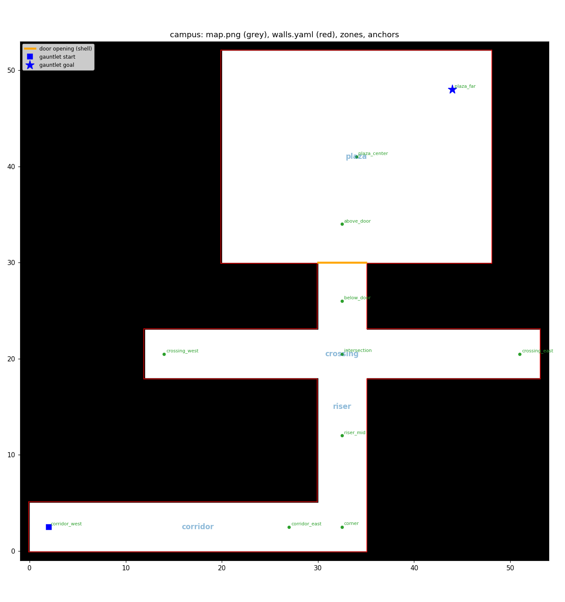

# 14. Building the campus stress-test world (guide)

A hands-on guide for building **one world that contains every stress scenario** (narrow corridor with counterflow,
doorway against an exiting crowd, blind corner, intersection with crossing streams, dense plaza), plus a
**procedural scenario generator** that turns parameter ranges and a seed into Arena scenarios.

You write the interesting parts. The boilerplate has the plumbing done and `TODO`s where your code goes:

| File | What it is | Your part |
|---|---|---|
| [`scripts/generate_campus.py`](../scripts/generate_campus.py) | Builds the world shell → `worlds/campus/` | 4 small `TODO`s (steps 1–3) |
| [`scripts/generate_campus_scenario.py`](../scripts/generate_campus_scenario.py) | Builds scenarios: template + parameters + seed → JSON | 4 templates + the gauntlet (one worked example included) |
| [`scenarios/campus/stress.yaml`](../scenarios/campus/stress.yaml) | Spec: which templates, parameter ranges, HuNav defaults | add a block per template you write |
| `worlds/campus/` | Generated output (map, walls, zones, scenarios, previews) | generated, don't edit by hand |

Prerequisites: [04](04-configuring-sim-and-robot.md) (worlds, scenarios, the YAML merge chain),
[09](09-hallway-scenarios.md) (scenario JSON fields and HuNav pitfalls). `generate_hallway.py` and
`generate_scenario.py` are the hallway versions of these scripts and are worth reading first.

---

## 1. The mental model: what is static, what is per-run

| Layer | Files | Changes when | Contains |
|---|---|---|---|
| **World** | `worlds/<w>/map/map.png`, `map.yaml`, `walls.yaml` | Only at launch. A *new* world folder also needs a rebuild of `arena_simulation_setup` | The building's walls. Gazebo builds wall boxes from `walls.yaml`; Nav2 plans on `map.png` |
| **Scenario** | `worlds/<w>/scenarios/<s>.json` | Every launch (pick with `scenario:=<s>.json`), no rebuild | Robot start and goal; pedestrians (start, waypoints, speed, HuNav behaviour, groups); **static obstacles** |

The trick for "one world, many geometries": the world shell is **generous** (5 m-wide corridors, a 5 m-wide door
opening). Each scenario **narrows it** by spawning wall panels as static obstacles. A 2.2 m corridor and a 3.8 m
corridor are then two scenario files, not two worlds.

How Arena finds things: `arena-launch.sh campus scenario scenario:=door_exit_s3.json` (world `campus`) →
`~/arena_ws/src/arena/simulation-setup/worlds/campus/{map,scenarios}/`. Our files live in this repo and are
**symlinked** there file by file (`--link`, see `link_into_arena()` in `generate_hallway.py`). The rules:
- **Editing** a file that is already linked → nothing else needed (symlink install).
- **A new file** (a new world, or new scenario files) → re-link (`--link`) **and** rebuild:
  `cd ~/arena_ws && source arena.bash && colcon build --symlink-install --packages-select arena_simulation_setup`
  (~25 s).

---

## 2. The proposed layout



(Generated by the finished `generate_campus.py`; yours will look the same once steps 1–3 are done.)

| Zone | Rectangle (x0, y0, x1, y1) | Stress |
|---|---|---|
| `corridor` | (0, 0, 35, 5) | **Counterflow** in a corridor narrowed by panels. Its east end, where it meets the riser, is the **blind corner** |
| `riser` | (30, 0, 35, 30) | Vertical corridor linking everything. Crosses the `crossing` corridor = the **intersection** |
| `crossing` | (12, 18, 53, 23) | East-west corridor with **crossing streams** |
| `plaza` | (20, 30, 48, 52) | **Dense plaza**. Its south wall has the **door** (x 30–35 at y = 30), narrowed by panels |

**Anchors** are named points the scenario generator uses for robot tasks and routes (`corridor_west`, `corner`,
`intersection`, `below_door`, `plaza_far`, …), written to `worlds/campus/zones.yaml`. The **gauntlet** task
(`corridor_west` → `plaza_far`) passes through every zone: about 80 m, ~100 s for DS-RNN and ~6 min for DWB.

Design rules baked into the layout (each one is a lesson from the hallway):
- **Everything axis-aligned.** HuNav computes obstacle forces from axis-aligned bounding boxes; rotated walls
  created phantom walls ([09 §4](09-hallway-scenarios.md#4-pitfalls-we-hit-and-the-fix-in-the-generator)).
- **Goals ≥ 3 m from walls.** DS-RNN overshoots goals and pinned itself on a wall 1 m behind the goal
  ([first experiment](../first_experiment/README.md)).
- **A tree, not a loop.** Zones connect without enclosing a hole, so the outline is one ring and
  `gen_walls()` from the hallway generator works unchanged. (A loop is possible; see the step 1 hints.)
- **Zones are separated.** Each template keeps its pedestrians inside its own zone, so the five stress situations
  stay independent and can be combined (the gauntlet) or run alone.

Change the layout by editing `ZONES` / `DOOR` / `ANCHORS` at the top of `generate_campus.py`.

---

## 3. Build the world shell (your TODOs in `generate_campus.py`)

Read `write_campus_world()` first: it calls your functions in order, then the finished helpers.

**Step 1: `build_free_space(zones)`.** Union the zone rectangles into ONE shapely `Polygon`: the walkable floor.
Raise a clear error if the result is a `MultiPolygon` (some zone isn't touching the rest). *Hint:* `box()` and
`shapely.union_all()`, exactly like `gen_blocks()` / `write_hallway_world()` in `generate_hallway.py`.

**Step 2: `build_walls(free)` and step 2b: `save_map_png_with_holes(...)`.** For the tree layout these are
one-liners that call the hallway versions (`gen_walls`, `save_map_png`). The interesting part is understanding
*why* they work: read their docstrings (half-thickness offset, mitre joins, image rows vs map y). Guard against
holes (`free.interiors`) with a clear error.

**Step 3: `save_default_scenario(world_dir)`.** `default.json` with the gauntlet start/goal and no pedestrians, so
you can drive the empty world first.

**Checkpoint A: look at it.**
```bash
uv run scripts/generate_campus.py
xdg-open worlds/campus/preview.png      # red walls hug the black band? zone labels + anchors where expected?
```

**Checkpoint B: drive it.**
```bash
uv run scripts/generate_campus.py --link
cd ~/arena_ws && source arena.bash && colcon build --symlink-install --packages-select arena_simulation_setup
cd ~/Documents/Lyu_Lab/initial-arena-testing
bash scripts/arena-launch.sh --record campus scenario scenario:=default.json rviz:=false local_planner:=dwb
```
DWB should drive the whole gauntlet (about 80 m, ~6 min at 0.26 m/s). Watch it in Gazebo; afterwards play it back
(`uv run scripts/playback.py ~/arena_runs/<run>/episode_000`). If the robot spawns inside a wall or the plan
looks wrong, `map.yaml`'s origin and `walls.yaml` disagree. Compare with `preview.png`.

---

## 4. Anatomy of a scenario JSON

```json
{
  "robots": [{"start": [2.0, 2.5, 0.0], "goal": [44.0, 48.0, 0.0]}],
  "obstacles": {
    "static":  [{"name": "narrow_s_0", "model": "cuboid", "pos": [6.5, 0.0, 0.0]}, "..."],
    "dynamic": [{"name": "oncoming_0", "model": "actor1", "type": 1,
                 "pos": [12.3, 2.4, 0.0], "waypoints": [[4.1, 2.6, 0.0], [28.8, 2.2, 0.0]],
                 "desired_velocity": 1.2, "group_id": -1, "radius": 0.35, "goal_radius": 0.6,
                 "cyclic_goals": true,
                 "behavior": {"type": 1, "social_force_factor": 5.0, "obstacle_force_factor": 10.0}}],
    "interactive": []
  }
}
```
- `static`: models from `simulation-setup/entities/obstacles/static/<model>/`; `pos` = [x, y, yaw].
  (⏳ panel details pending verification, §5.)
- `dynamic`: HuNav pedestrians. The gotchas from [09 §3](09-hallway-scenarios.md):
  - `social_force_factor` defaults to 0, so people walk through each other: always set it;
  - `type` must be the integer 1;
  - waypoints are walked in order and looped with `cyclic_goals`;
  - two people aiming at the same exact point overlap, so jitter waypoints.

You never write this by hand: `Builder` in `generate_campus_scenario.py` does (`set_robot`, `add_pedestrian`,
`block_rect`, `jitter`, `new_group`).

---

## 5. Panels: adjusting geometry per scenario

`Builder.block_rect(x0, y0, x1, y1)` fills an axis-aligned rectangle with Arena's stock 1 × 1 × 2.2 m `cuboid`
boxes, overlapping where needed. Rectangles may extend *into* walls, which is how you make a thin ledge along a
wall (the worked example narrows the corridor this way).

- **Narrow a corridor:** one rectangle along each long wall (see `corridor_counterflow`).
- **Make a door of width w in the 5 m opening:** one rectangle on each side of the gap, about 1 m deep.

> ⏳ **Being verified now:** do HuNav pedestrians avoid spawned boxes? Does Nav2's global planner know about them
> (they aren't in `map.png`)? How expensive are ~80 boxes? Would thin, long panel models be better? This section
> will be updated with the answers.

---

## 6. Scenario templates

A template is a function `f(campus, b, p)`:
- `campus` gives you zone rectangles and anchors;
- `b` is the `Builder` you fill;
- `p` is the **sampled** parameter dict from the spec.

Register it in `TEMPLATES` and add a block to `stress.yaml` with the same name.

### 6.1 Worked example: `corridor_counterflow`
Read it top to bottom. The pattern every template follows:
1. **Geometry:** compute what to block from the parameters (`side = (5 m − width) / 2` per wall), then call `block_rect`.
2. **Robot task:** `b.set_robot(anchor, anchor)`.
3. **Crowd:** per pedestrian, a speed drawn from `p["speed"]`, a start, and a looping route of jittered waypoints
   that stays inside the zone (and 0.4 m off the panels).

```bash
uv run scripts/generate_campus_scenario.py scenarios/campus/stress.yaml --only corridor_counterflow --seeds 0 4
xdg-open worlds/campus/previews/corridor_counterflow_s0.png
```

### 6.2 `door_exit`: doorway against an exiting crowd
- **Stress:** waiting vs pushing. Can the robot hold back while a crowd comes through a 1 m door, then go?
- **Expected failures:** freezing forever (DWB), or forcing through people (DS-RNN).
- **Parameters:** `door_width` 0.9–2.0 m, `n_exiting` 8–20, `speed`.
- **Pitfalls:**
  - pedestrians can catch on panel corners: put a waypoint exactly in the door's centre;
  - start most of the crowd in the plaza, so the exit flow is under way when the robot arrives.

### 6.3 `blind_corner`
- **Stress:** occlusion and reaction time. People appear around the corner with little warning.
- **Expected failures:** collisions at the corner, especially for fast walkers. DWB only sees them once the lidar
  does; DS-RNN "sees" through walls (perfect perception), so this template exposes the perception asymmetry most
  clearly.
- **Parameters:** `n` 3–8, `speed` up to 2 m/s, optional `width` of the riser.
- **Pitfall:** timing. Spread start heights so someone is always about to come round the corner.

### 6.4 `intersection`: crossing streams
- **Stress:** finding a gap in perpendicular traffic.
- **Expected failures:** hesitation (long waits), cutting in front, splitting groups.
- **Parameters:** `n_east` / `n_west` 4–10, `speed`, `group_frac`.
- **Pitfall:** keep-right lanes (`route_lane` in `generate_scenario.py`), otherwise the streams collide head-on
  and jam.

### 6.5 `plaza_dense`
- **Stress:** density out of distribution. DS-RNN was trained with 5 people and attends to the 5 nearest.
- **Expected failures:** collisions with the 6th-nearest person; DWB costmap clutter, leading to freezing.
- **Parameters:** `n` 15–40, `speed`, behaviour mix.
- **Pitfall:** keep random milling points ≥ 1.5 m off walls, or people pile up against them.

### 6.6 `gauntlet`
All of the above in one long episode: call the other templates, then override the robot task. Do this last.

**Checkpoint C** for each template: generate 3–5 seeds, check the previews, then run one in Arena with `--record`
and watch the playback. Are people actually going where you intended? Does the stress happen *while the robot is
there*?

---

## 7. Procedural generation: seeds, ranges, manifest

```bash
uv run scripts/generate_campus_scenario.py scenarios/campus/stress.yaml --seeds 0 29 --no-preview --link
```
- **Same spec + seed → the same JSON.** Each (template, seed) gets its own random stream, so adding a template
  doesn't change the others.
- `worlds/campus/scenarios/manifest.csv` records the **sampled parameters of every scenario file**. In the
  analysis, join it with the recorded outcomes (the run's `scenario`) to plot e.g. success vs door width or
  collisions vs density.
- **Choosing ranges:** start wide, look at where performance falls off a cliff, then sample densely around the
  cliff. Difficulty *curves* are the result you want, not single averages.
- **Paired design:** give every planner the *same* scenario files, so comparisons are per-scenario (paired tests,
  much more statistical power).

---

## 8. Making pedestrians react to the robot

HuNav's behaviour types 3–6 (surprised, scared, curious, threatening) need the robot to be tracked, and our HuNav
plugin has robot tracking commented out. Today pedestrians treat the robot as an obstacle (their obstacle force
pushes them away from its body), but they never anticipate, yield to or react to it. Re-enabling this is a
separate task. Until then, use behaviour types 1 and 2 only.

---

## 9. Running many scenarios

Each scenario is one launch with the scheduler ([12 § Batches](12-recording-and-playback.md)):
```yaml
jobs:
  - {name: cc_s0_dwb,   planner: dwb,   world: campus, scenario: corridor_counterflow_s0.json, episodes: 3}
  - {name: cc_s0_dsrnn, planner: dsrnn, world: campus, scenario: corridor_counterflow_s0.json, episodes: 3}
```
> ⏳ **Being verified now:** whether Arena can switch scenario files *between episodes without relaunching*. If
> it can, the scheduler will get a "list of scenarios per launch" mode, which saves ~1 min of startup per
> scenario.

---

## 10. Suggested order of work

1. §3 steps 1–3, then checkpoints A and B (drive the empty campus with DWB).
2. Run the worked example (§6.1) in Arena and watch it.
3. Write `door_exit`, then `blind_corner`, `intersection` and `plaza_dense`, with checkpoint C after each.
4. `gauntlet`.
5. Generate ~10 seeds per template and do a small pilot with DWB and DS-RNN (scheduler + a copy of the
   first-experiment notebook).
